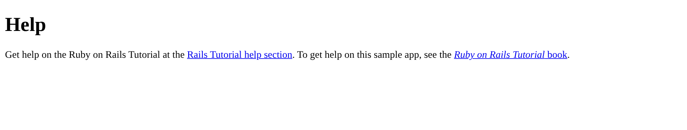
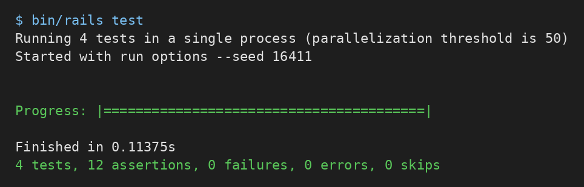
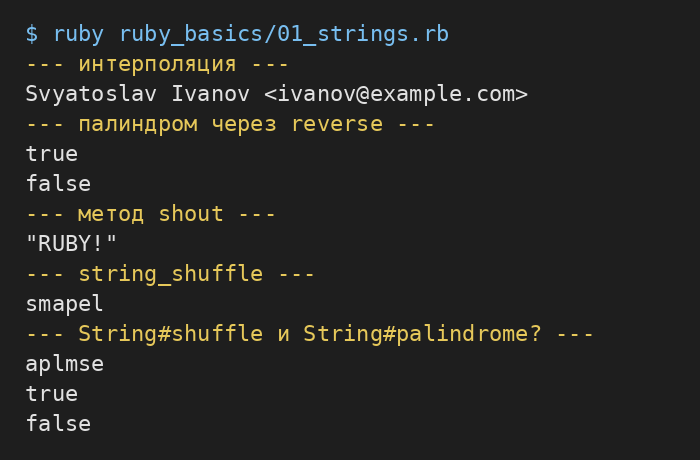
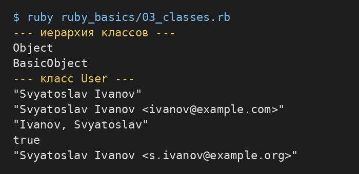
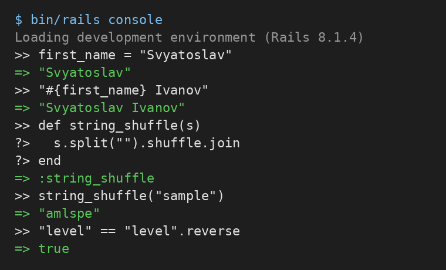
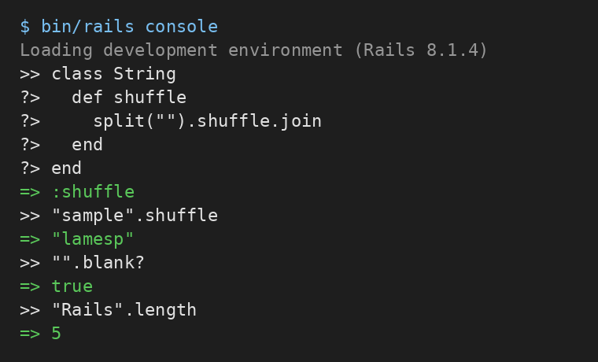
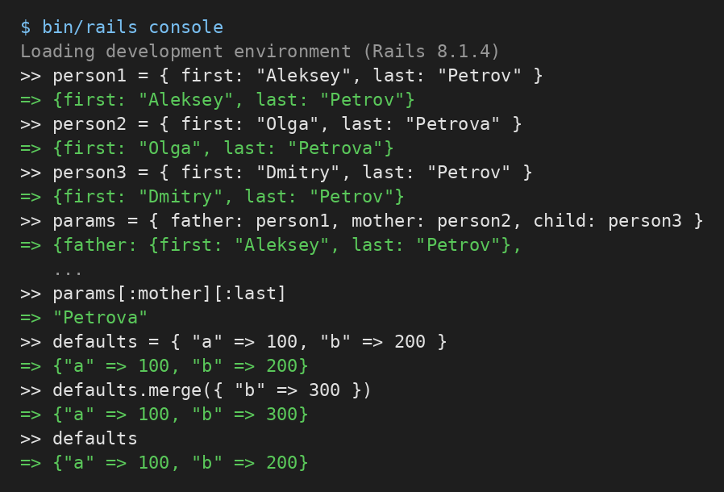
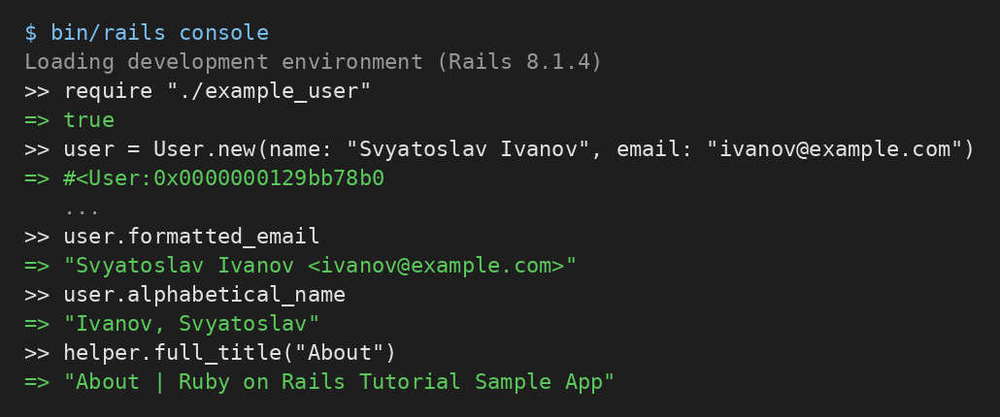

# Sample App — лабораторная работа 4

**Тема:** основы Ruby, которые нужны в Rails (глава 4 *Ruby on Rails Tutorial*).
Студент: Иванов С., группа 4411.

За основу взято приложение со статическими страницами из лабораторной 3.

## Состав работы

| Что | Где |
|---|---|
| Хелпер заголовка `full_title` (константа `BASE_TITLE`, тернарный оператор, интерполяция) | `app/helpers/application_helper.rb` |
| Вызов хелпера в макете | `app/views/layouts/application.html.erb` |
| Тесты заголовков страниц | `test/controllers/static_pages_controller_test.rb` |
| Класс `User` без Active Record | `example_user.rb` |
| Упражнения: строки и методы | `ruby_basics/01_strings.rb` |
| Упражнения: массивы, диапазоны, блоки, хэши | `ruby_basics/02_collections.rb` |
| Упражнения: классы | `ruby_basics/03_classes.rb` |

## Как проверить

```sh
bundle install
bin/rails test
bin/rails server                  # открыть http://localhost:3000
ruby ruby_basics/01_strings.rb
ruby ruby_basics/02_collections.rb
ruby ruby_basics/03_classes.rb
```

Отчёт лежит в корне проекта: `ЛР4_Иванов_отчет.docx`.

## Мини-отчёт

### Немного теории

- **Строки и методы** — интерполяция `#{...}`, значения аргументов по умолчанию, неявный возврат результата.
- **Блоки** — код, который методы `each`, `map`, `select` вызывают для каждого элемента коллекции.
- **Хэши и символы** — пары «ключ — значение»; параметры запроса в Rails устроены как вложенные хэши.
- **Классы** — можно наследовать и дополнять, включая встроенный `String`.

### Результаты

1. Хелпер `full_title` записан через тернарный оператор:

   ```ruby
   BASE_TITLE = "Ruby on Rails Tutorial Sample App"

   def full_title(page_title = "")
     page_title.empty? ? BASE_TITLE : "#{page_title} | #{BASE_TITLE}"
   end
   ```

   Страница Help с заголовком «Help | Ruby on Rails Tutorial Sample App»:

   

2. Тесты заголовков — 4 теста, 12 проверок, без ошибок:

   

3. Упражнения по строкам (`ruby ruby_basics/01_strings.rb`):

   

4. Класс `User` (`ruby ruby_basics/03_classes.rb`):

   

### Консоль Rails

Примеры из методички и упражнения 4.6, набранные в `bin/rails console`:

| Что | Снимок |
|---|---|
| Интерполяция, `string_shuffle` (упр. 1), палиндром |  |
| `String#shuffle` (упр. 2), `blank?`, `length` |  |
| Вложенные хэши и `merge` (упр. 3 и 4) |  |
| Класс `User` и `helper.full_title` |  |

### Итог

Заголовки всех страниц формирует один хелпер, что подтверждают тесты. На упражнениях отработаны блоки, хэши и расширение встроенных классов.
